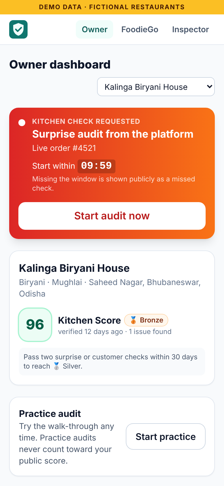
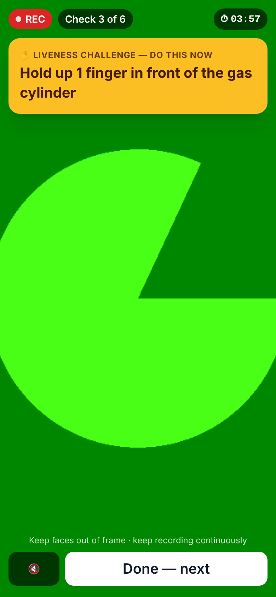
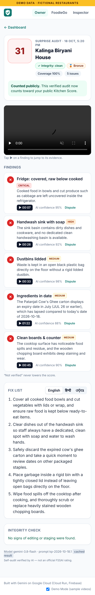
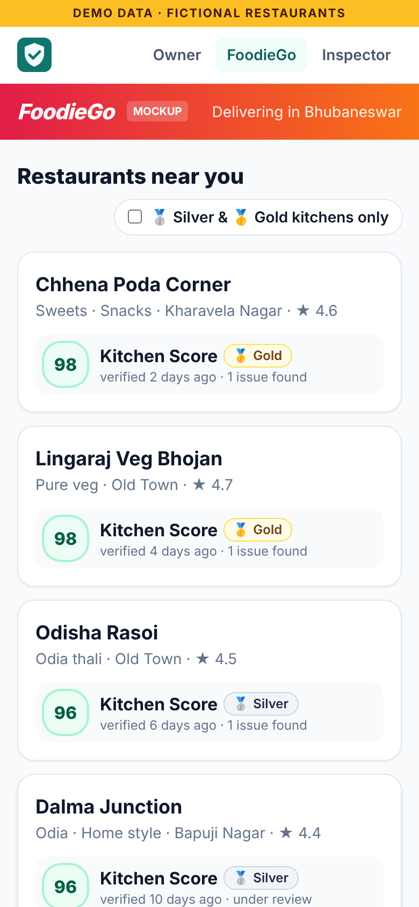
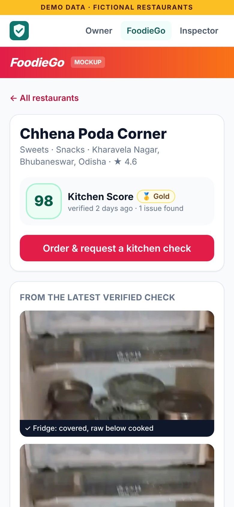
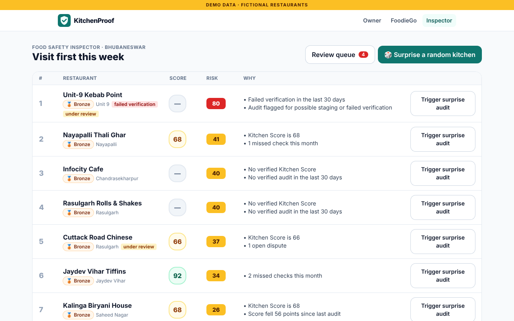
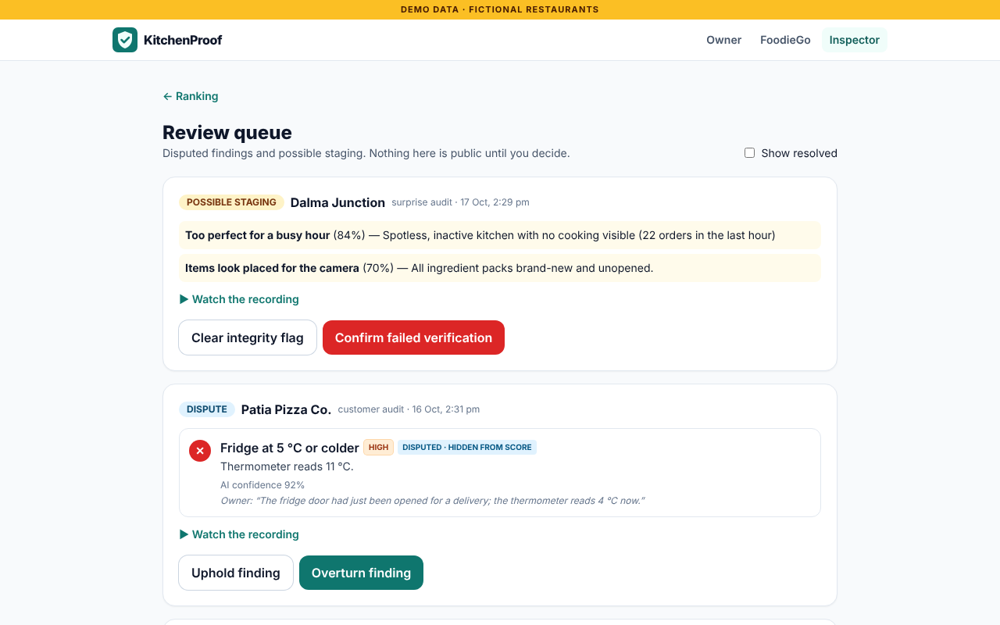
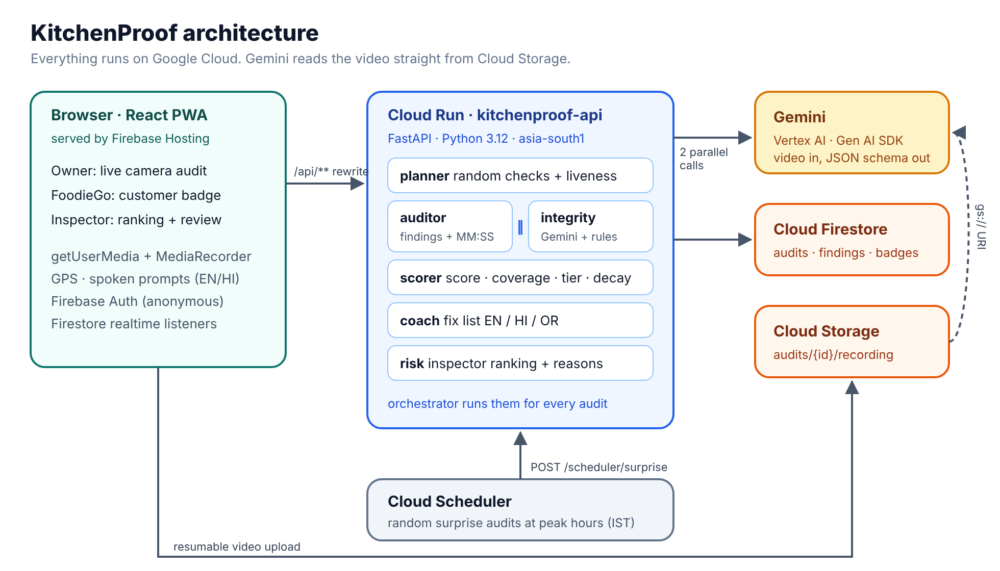

# KitchenProof

**Surprise, AI-verified kitchen audits from a phone.** Built with Gemini on Google Cloud for the
Google Cloud AI Builder Cup 2026 — theme: *Retail & Commerce — Intelligent Customer and Business Experiences*.

> *"We can't stop someone faking one video. KitchenProof makes faking it every day, at random times,
> while real orders are cooking, harder than just keeping the kitchen clean."*

**Demo:** `https://<your-project>.web.app/tour` · *(add the deployed link, demo video and deck here)*

---

## Problem

Since May 2026, Maharashtra FDA raids under Commissioner Tukaram Mundhe have exposed cockroaches, rats and
rotting food in well-known kitchens (3,000+ raids; permits suspended at major chain outlets — Reuters,
24 Aug 2026). Experts say inspections alone can't fix it: the state would need about 2,000 food safety
officers (AFP). Customers ordering online never see the kitchen at all.

## Solution

At unpredictable moments — a surprise from the platform, or a customer's request during their own order —
the restaurant must do a short **live camera walk-through** in the app. Randomly chosen checks are revealed
**one at a time** ("open the fridge and show each shelf", "show order #4521 being prepared right now"),
with a random **liveness gesture** ("hold up 3 fingers in front of the stove").
**Gemini** scores the recording against FSSAI-style hygiene checks with **timestamped evidence**, and a
separate **integrity check** looks for staging. Customers see a verified **Kitchen Score** with an
**evidence tier**; inspectors get a **ranked list** of kitchens to visit first.

## Try it in 2 minutes

Open the link and press **"Start the 2-minute demo tour"**. A guide bar walks you through:

1. **Inspector** triggers a surprise audit on *Kalinga Biryani House*.
2. **Owner** sees the request with a live 10-minute countdown.
3. **Live audit** — in Demo Mode pick *Messy kitchen* under "Use a sample video" (real Gemini analysis).
4. **Report** — score ~40 (critical fail caps the score), tap ▶ on any finding to jump to the evidence; try **Dispute**.
5. **Customer (FoodieGo)** orders, requests a kitchen check, answers it with the *Clean kitchen* sample → badge turns 🥈 Silver.
6. **Inspector ranking** with plain-language reasons + **review queue** with a "too perfect for a busy hour" staging flag.

No login: the app signs judges in anonymously. Turn Demo Mode off (footer) to use the real camera.

## Screenshots

| Owner: surprise request | Live audit: liveness challenge | Audit report |
|---|---|---|
|  |  |  |

| FoodieGo: restaurants | FoodieGo: kitchen badge |
|---|---|
|  |  |

| Inspector: visit first this week | Inspector: review queue |
|---|---|
|  |  |

## Features

- Three audit triggers: `surprise` (platform), `customer` (during a live order), `practice` (never counts).
- Live Audit: in-app continuous recording (`getUserMedia` + `MediaRecorder`), server-revealed checks, liveness card, GPS, 4-minute limit, prompts read aloud in English or Hindi.
- **Auditor agent (Gemini)**: per check `pass | fail | not_verified`, reason, `MM:SS` timestamp, confidence, readable labels, evidence clips.
- **Integrity agent (Gemini + rules)**: liveness, continuous take, same kitchen as reference, activity vs order volume, props, repeated items, location, speed → `clean | suspicious | failed`.
- **Coach agent (Gemini)**: fix list in English, Hindi and Odia.
- Deterministic scorer, evidence tiers, decay and inspector risk ranking with reasons.
- Audit report with evidence player, dispute flow, inspector review queue, inspector visit (confirms → Gold, contradicts → "Failed verification").
- FoodieGo mockup (made-up brand): badges, tier explainer, 3 public evidence clips, customer spot check.
- Demo Mode: 15 fictional Bhubaneswar restaurants, sample videos, cached fallback so the demo never dead-ends, guided tour.
- Installable PWA, mobile-first owner/customer screens, desktop inspector view, optional Google Maps risk map.

## Anti-fake and anti-false design

| Stops owners faking | Protects owners from wrong AI findings |
|---|---|
| Unannounced timing (owner can't create surprise audits) | "Not verified" lowers coverage, never the score |
| 10 min to start, 4 min to finish — else a public **missed check** | Confidence < 0.6 → human review, never public |
| Checks revealed one at a time; the plan is stored server-side only (`auditSecrets`) | Critical fail needs confidence ≥ 0.8 to cap the score |
| Live order on camera (`order_prep`) | Every finding has a timestamp; no evidence → no penalty |
| Random liveness gesture verified by Gemini | Coverage < 70% → inconclusive + quick re-audit |
| In-app continuous capture only; cuts and jumps flagged | Dispute any finding → hidden until an inspector decides |
| GPS within 200 m of the registered address | "Suspicious" ≠ guilty: public sees only "under review" |
| Scene compared with the kitchen's reference audit | Careful public wording + disclaimer on every badge |
| "Too perfect" for the hour's order volume | Model ID and prompt version stored on every audit |
| Same unopened item (batch/expiry) in 3+ audits | |
| Evidence tiers: a staged one-off video can never exceed 🥉 Bronze | |
| Inspector visit outweighs self-audit; contradiction → "Failed verification" for 30 days | |
| Score decays without fresh verified audits | |

Customers can only request a check on their own active order: 1 per restaurant per 7 days, max 3 per kitchen per day.
Gemini is told never to identify people; public clips are 3–5 s of surfaces and equipment from passing checks.

## Architecture



```
Browser (React PWA on Firebase Hosting)
  ├─ Firebase Auth (anonymous) · Firestore realtime listeners · Cloud Storage resumable upload
  └─ /api/**  ──(Hosting rewrite)──▶  Cloud Run: kitchenproof-api (FastAPI, Python 3.12, asia-south1)
                                        ├─ planner     random checks + liveness (deterministic)
                                        ├─ auditor     Gemini: gs:// video + instruction timeline → findings JSON
                                        ├─ integrity   Gemini + rules → clean | suspicious | failed
                                        ├─ coach       Gemini (text): EN / HI / OR fix list
                                        ├─ scorer/risk deterministic score, tier, decay, ranking
                                        └─ Firestore (google-cloud-firestore) · Gemini on Vertex AI
Cloud Scheduler (optional) ──▶ /api/scheduler/surprise
```

Per completed audit the orchestrator runs **auditor ∥ integrity** (two Gemini calls on the same `gs://` video)
→ scorer → coach → writes results → recomputes the restaurant's score, tier and risk.
Analysis runs as a background task (the Hosting → Cloud Run rewrite has a 60 s limit), and the browser
follows the audit status through a Firestore listener.

## Google tech used

- **Gemini** (newest Flash model in the project, `gemini-3.8-flash` by default via `GEMINI_MODEL`; fallback `gemini-flash-latest`) through the **Google Gen AI SDK** on **Vertex AI**, with structured JSON output (`response_schema`) and native video understanding from Cloud Storage URIs
- **Cloud Run** (API) · **Firebase Hosting** (web app + `/api` rewrite) · **Cloud Firestore** · **Cloud Storage for Firebase** · **Firebase Authentication** (anonymous)
- **Cloud Scheduler** (optional real surprise audits) · **Google Maps JavaScript API** (optional inspector map)

## Repo layout

```
backend/   FastAPI app (app/agents: planner, auditor, integrity, coach, scorer, risk, orchestrator), prompts, demo seed, tests
frontend/  React + Vite + TypeScript + Tailwind PWA (pages: owner, customer, inspector, tour)
scripts/   test_auditor.py (Phase 0), seed_firestore.py, upload_demo_assets.py
demo-assets/  sample videos (recorded by the team) — see demo-assets/README.md
```

## Local setup

```bash
# Backend (no GCP needed: in-memory data, cached Gemini results for sample videos)
cd backend
python3 -m venv .venv && . .venv/bin/activate
pip install -r requirements-dev.txt
pytest                                  # unit + API tests
DATASTORE=memory DEMO_MODE=true uvicorn app.main:app --port 8080 --reload
# Real Gemini locally: add GEMINI_API_KEY=... (AI Studio) or
#   GOOGLE_GENAI_USE_VERTEXAI=true GOOGLE_CLOUD_PROJECT=... (after gcloud auth application-default login)

# Frontend (proxies /api to :8080)
cd frontend
npm install
npm run dev                             # http://localhost:5173
```

Without Firebase config the web app polls the API and uploads recordings through `/api/audits/{id}/upload`.
The camera needs HTTPS (or `localhost`).

**Full Firebase setup locally** (Auth, Firestore, Storage emulators with the real security rules; needs Java):

```bash
npx firebase-tools emulators:start --project demo-kitchenproof --only auth,firestore,storage
# backend, in another terminal:
DATASTORE=firestore FIRESTORE_EMULATOR_HOST=127.0.0.1:8085 GOOGLE_CLOUD_PROJECT=demo-kitchenproof uvicorn app.main:app --port 8080
# frontend: put these in frontend/.env.local, then npm run dev
VITE_USE_EMULATORS=true
VITE_FIREBASE_API_KEY=fake-api-key
VITE_FIREBASE_PROJECT_ID=demo-kitchenproof
VITE_FIREBASE_STORAGE_BUCKET=demo-kitchenproof.appspot.com
VITE_FIREBASE_APP_ID=1:1:web:1
```

**Phase 0 check** (does Gemini see the obvious problems?):

```bash
GEMINI_API_KEY=... python scripts/test_auditor.py demo-assets/messy_kitchen.mp4 backend/app/demo/timelines/messy.json
```

## Deploy

```bash
gcloud config set project $PROJECT_ID
REGION=asia-south1
gcloud services enable run.googleapis.com cloudbuild.googleapis.com artifactregistry.googleapis.com \
  firestore.googleapis.com aiplatform.googleapis.com storage.googleapis.com secretmanager.googleapis.com cloudscheduler.googleapis.com
# Firebase console: add Firebase to the project; enable Auth → Anonymous; Firestore (Native, asia-south1); Storage.

gcloud iam service-accounts create kitchenproof-api
SA=kitchenproof-api@$PROJECT_ID.iam.gserviceaccount.com
for role in roles/aiplatform.user roles/datastore.user roles/storage.objectViewer; do
  gcloud projects add-iam-policy-binding $PROJECT_ID --member=serviceAccount:$SA --role=$role
done
printf '%s' "$(openssl rand -hex 16)" | gcloud secrets create scheduler-secret --data-file=-
printf '%s' "$(openssl rand -hex 16)" | gcloud secrets create admin-secret --data-file=-
for s in scheduler-secret admin-secret; do
  gcloud secrets add-iam-policy-binding $s --member=serviceAccount:$SA --role=roles/secretmanager.secretAccessor
done

# Sample videos → gs://$BUCKET/demo-assets/ and frontend/public/demo/
BUCKET=$PROJECT_ID.firebasestorage.app
STORAGE_BUCKET=$BUCKET python scripts/upload_demo_assets.py

# Backend (--no-cpu-throttling keeps CPU for the background Gemini analysis)
cd backend
gcloud run deploy kitchenproof-api --source . --region $REGION \
  --service-account $SA --allow-unauthenticated --timeout 300 --memory 1Gi --no-cpu-throttling \
  --set-env-vars GOOGLE_GENAI_USE_VERTEXAI=true,GOOGLE_CLOUD_PROJECT=$PROJECT_ID,GOOGLE_CLOUD_LOCATION=global,GEMINI_MODEL=gemini-3.8-flash,DEMO_MODE=true,STORAGE_BUCKET=$BUCKET \
  --set-secrets SCHEDULER_SECRET=scheduler-secret:latest,ADMIN_SECRET=admin-secret:latest
cd ..

# Frontend
cp frontend/.env.example frontend/.env.production   # fill in the Firebase web config
sed -i "s/YOUR_PROJECT_ID/$PROJECT_ID/" .firebaserc
(cd frontend && npm ci && npm run build)
firebase deploy --only hosting,firestore:rules,firestore:indexes,storage

# Optional: real surprise audits at peak hours (IST)
gcloud scheduler jobs create http surprise-audits --location $REGION \
  --schedule "*/30 12-15,19-23 * * *" --time-zone "Asia/Kolkata" \
  --uri https://$PROJECT_ID.web.app/api/scheduler/surprise --http-method POST \
  --headers X-Scheduler-Secret=<secret>
```

If Gemini reports a permission error reading the video, grant `roles/storage.objectViewer` on the bucket to
the Vertex AI service agent (`service-<PROJECT_NUMBER>@gcp-sa-aiplatform.iam.gserviceaccount.com`).
The API seeds demo data on first start; re-seed with `POST /api/demo/reset` (header `X-Admin-Secret`).

**Smoke test:** `/api/health` returns the model ID · the tour runs end to end on a laptop and a phone ·
a real camera audit uploads and produces a report.

## Limitations & roadmap

- Prototype: no real identity for owners/inspectors (role pages are open); Firestore rules are prototype-level.
- If the page reloads mid-recording, the recording restarts from the current check.
- Visual checks only — oil quality and temperature are flagged, never certified; no lab testing.
- Roadmap: delivery-rider pickup photo checks, FoodieGo/FSSAI integrations, push notifications (FCM),
  Gemini Live voice guide, ADK orchestration, school mid-day meal kitchens and hostel messes.

## Disclaimer

Kitchen Scores are **self-audits verified by AI — not an official FSSAI rating**. FoodieGo is a made-up brand;
all restaurants, orders and audits in Demo Mode are fictional. No real brand is a partner.
